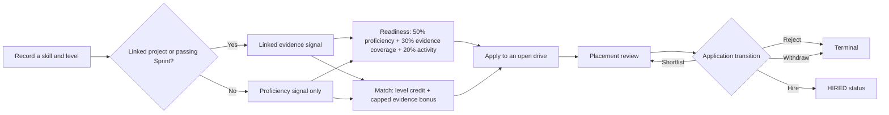
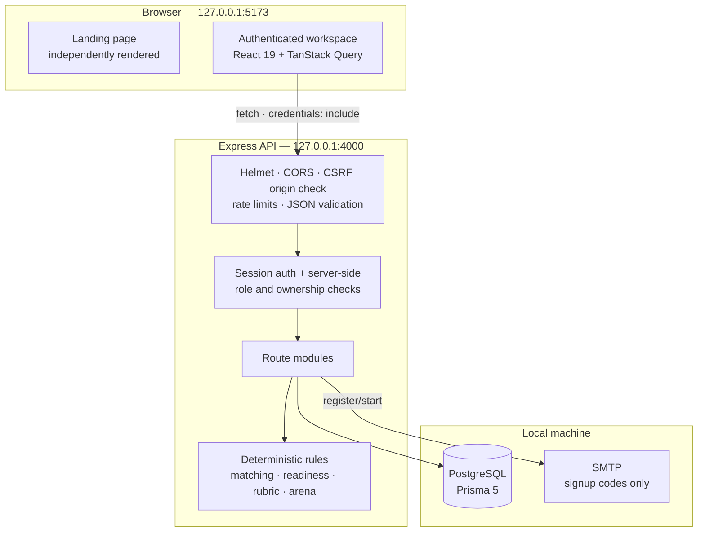
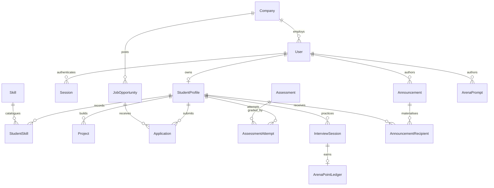

<div align="center">

# CAMPUSLINK

**Career intelligence for students. One connected record for placement cells.**

Record what you can do. Attach the work that supports it. Rank the roles that fit.
Practice the interview. Move the application forward — without a spreadsheet behind it.

`React 19` · `TypeScript` · `Express` · `Prisma` · `PostgreSQL`

**Local-first. Deterministic. Inspectable.**

</div>

> A skill is a claim. Linked evidence adds context. CAMPUSLINK is built around that distinction.

## Contents

- [Why CAMPUSLINK](#why-campuslink)
- [What it is](#what-it-is)
- [Surface map](#surface-map)
- [The student loop](#the-student-loop)
- [Architecture](#architecture)
- [Engineering decisions](#engineering-decisions)
- [Data model](#data-model)
- [Security and trust](#security-and-trust)
- [Stack](#stack)
- [Repository layout](#repository-layout)
- [Run it locally](#run-it-locally)
- [Configuration](#configuration)
- [Routes](#routes)
- [API overview](#api-overview)
- [What is scored, and how](#what-is-scored-and-how)
- [Demo data and honesty rules](#demo-data-and-honesty-rules)
- [Testing and quality](#testing-and-quality)
- [Limitations and next steps](#limitations-and-next-steps)
- [Further reading](#further-reading)

## Why CAMPUSLINK

Students describe themselves in résumés. Placement cells track them in spreadsheets. Job
portals rank them with scores nobody can inspect. Each system knows a different version of
the same person.

CAMPUSLINK keeps one version. A student's skills, projects, practice attempts, applications
and placement decisions are persisted in the same PostgreSQL database across linked tables.
The detailed match and readiness endpoints return their method plus factors or inputs;
aggregate dashboard figures are simpler. Every application is a row with a server-enforced
state machine. The matching and assessment logic is deterministic and rule-based, not an AI
prediction.

The result is a local-first working system with two connected workspaces:

- **Students** build an evidence-linked profile, find roles that fit, practise interviews and
  track real applications.
- **Placement cells** publish drives, review applicants, see batch-level activity, send
  in-app announcements and manage the interview question bank.

## What it is

CAMPUSLINK is a monorepo with a React/Vite frontend and an Express/TypeScript/Prisma API.
It is designed to run on one machine against a local PostgreSQL database. There is no hosted
deployment, no Docker dependency and no analytics integration configured in this build.

> **Build context.** The project owner describes CAMPUSLINK as having been assembled in an
> approximately 8-hour AI-assisted development sprint to meet a specific set of requirements.
> The development window describes the build process—not a claim of production readiness;
> implementation details and current limitations are documented below.

**Delivery boundary:** SMTP is used only for student-registration verification codes.
Placement announcements and the resulting student notifications are in-app records in
PostgreSQL; general email, SMS and push notification delivery are not implemented.

| | Student workspace | Placement workspace |
| --- | --- | --- |
| **Purpose** | Link claims to evidence, then act on it | Run drives and review the batch from live records |
| **Core surfaces** | Career Twin, Opportunity Mirror, Skill Sprint, Applications, Interview Arena, Proof Passport | Placement Tower, Company Drives, Applications, Students, Announcements, Arena Bank |
| **Data ownership** | Own profile, skills, projects, attempts, sessions and notifications | Batch-wide read access; staff-only writes |
| **Entry point** | `/app` | `/tower` |

> **Scope note:** the backend supports a `RECRUITER` role with company-scoped access, but this
> build has no recruiter portal. Recruiter accounts see an explicit "portal unavailable" state
> rather than a student workspace.

## Surface map

### Student workspace

| Surface | Route | What it does |
| --- | --- | --- |
| **Overview** | `/app` | Readiness ring, application pipeline, top match gaps and next actions — all from server data |
| **Career Twin** | `/twin` | Skill record split into claims and linked project evidence; readiness inputs shown underneath |
| **Opportunity Mirror** | `/mirror` | Open drives ranked against the student's record, with met requirements, gaps and bonuses named |
| **Skill Sprint** | `/sprint` | Short briefs with persisted attempts; a passing grade follows the public rubric and can promote a skill |
| **Applications** | `/applications` | One record per job; duplicate prevention and only legal status transitions |
| **Interview Arena** | `/arena` | Curated practice prompts, scored answers and a points ledger |
| **Proof Passport** | `/passport` | Per-skill provenance, rubric-assessed attempts and the limits of what has been independently verified |
| **Notifications** | `/notifications` | Student-own in-app notices from placement announcements |

### Placement workspace

| Surface | Route | What it does |
| --- | --- | --- |
| **Placement Tower** | `/tower` | Batch counts, open drives, application status spread, readiness distribution and demo-seed flag |
| **Company Drives** | `/tower#drives` | Publish and edit drives; status can be changed among `DRAFT`, `OPEN` and `CLOSED`; required skills carry minimum levels |
| **Applications** | `/tower#applications` | Filter and review applications; shortlist, reject or mark hired only where the server allows it |
| **Students** | `/tower/students` | Searchable, branch-filterable directory of student profiles |
| **Student profile** | `/tower/students/:studentId` | Read-only view of a student's record for placement review |
| **Applicant review** | `/tower/applications/:applicationId` | Candidate and drive context with the same guarded transitions as the queue |
| **Announcements** | `/tower/announcements` | Publish notices to a materialised audience and see unread counts |
| **Arena Bank** | `/tower/arena` | Add, edit, deactivate or delete questions in the managed interview bank |

## The student loop



Four things happen at the same time, from the same linked data:

1. **Skills** are claims with a recorded level.
2. **Projects** link to skill names and add evidence context.
3. **Readiness** weights recorded proficiency, evidence coverage and capped activity.
4. **Matching** gives required skills level credit and adds a capped evidence bonus, with
   every gap named.

A project link is user-submitted evidence. A passing Skill Sprint is rubric-assessed evidence.
Neither is presented as independent verification; the Proof Passport reports
`independentlyVerifiedItems: 0` today. Evidence contributes to scoring, but it is not a
prerequisite for required-skill credit when the recorded level already meets the minimum.

## Architecture



The public landing page is deliberately outside `SessionProvider`. A visitor with the API
stopped still gets the full page; authenticated routes redirect to `/login?next=…` and return
after sign-in.

## Engineering decisions

| Decision | Why | Trade-off |
| --- | --- | --- |
| **Separate proficiency claims from linked evidence** | The system exposes both signals and applies documented formulas; evidence contributes a capped match bonus and a readiness component | User-reported skill levels are not independently verified |
| **Deterministic scoring** | Scoring logic is transparent and traceable to stored inputs; no model, embedding or LLM is involved | Not calibrated against hiring outcomes, and not predictive |
| **Protocol-style API responses** | `{ ok, data }` on success, sanitised `{ ok: false, error }` on failure | More verbose than ad-hoc JSON |
| **Guarded application workflow** | Application status transitions are server-enforced; drive status is ordinary management data | Drive status changes are less restricted than application status changes |
| **Server-side sessions** | The cookie is HttpOnly and only a SHA-256 hash is stored | No session listing or rotation yet |
| **Row-level ownership checks** | A student cannot read another student's record; a recruiter cannot cross company boundaries | Every route needs explicit scoping tests |
| **Email-verified student signup** | An account is created only after a single-use code is verified and a password is accepted | Registration needs SMTP configured; without it the API returns 503 |
| **Loopback-only local demo** | Keeps the unfinished operational surface off the network | Not a deployment architecture |
| **Synthetic seed, clearly flagged** | Demo views are useful without pretending to be real placements | Seed emails starting `demo.` are called out in the Tower |
| **Forward-only migrations** | No reset/wipe tooling can silently destroy local records | Schema changes must be additive or explicitly migrated |
| **Landing decoupled from auth** | Public page never waits on session or API readiness | Slight duplication of brand tokens and layout rules |

### What was deliberately not built

No AI/LLM features in the application. No recruiter portal. No hosted infrastructure. No
general email, SMS or push notification delivery—SMTP is limited to registration
verification. No password recovery. No placement-outcome analytics. These are scope
boundaries, not hidden claims.

## Data model

The Prisma schema is the source of truth. The simplified map below shows the relationships
that drive the product.



| Model group | Key records |
| --- | --- |
| **Identity** | `User` (`STUDENT`, `STAFF`, `RECRUITER`, `ADMIN`), `StudentProfile`, `Company`, `Session`, `RegistrationAttempt` |
| **Evidence** | `Skill`, `StudentSkill`, `Project`, `Assessment`, `AssessmentAttempt` |
| **Opportunity flow** | `JobOpportunity`, `Application` (`APPLIED`, `SHORTLISTED`, `REJECTED`, `HIRED`, `WITHDRAWN`) |
| **Practice** | `InterviewSession`, `ArenaPrompt`, `ArenaPointLedger` |
| **Communication** | `Announcement`, `AnnouncementRecipient` |

Two details matter for correctness:

- `RegistrationAttempt` stores the OTP and completion token as hashes. The real `User` row is
  created only after the emailed code and password are both accepted; profile fields are copied
  from the verified attempt, not from the final request.
- `AnnouncementRecipient` rows are materialised at publish time in one transaction, freezing
  the audience to whoever matched then.

## Security and trust

| Control | Implementation |
| --- | --- |
| **Passwords** | `scrypt` with per-user salt; never stored or returned in plaintext |
| **Sessions** | HttpOnly cookie `campuslink_session`, 7-day absolute expiry, `SameSite=Lax`, `Secure` when configured; only SHA-256(token) stored |
| **Authorization** | Role and row ownership enforced server-side on every authenticated route; `studentProfileId` in a request proves nothing |
| **Login** | Uniform `401 Invalid email or password` for unknown email, wrong password and inactive account; 20 attempts / 15 min / IP |
| **Signup OTP** | 6 digits from `crypto.randomInt`, stored as HMAC-SHA256 keyed on the attempt, single-use, 10-minute expiry, 5 wrong attempts and 5 sends |
| **Browser boundary** | Helmet headers, single loopback CORS origin with credentials, CSRF `Origin`/`Referer` check on mutations |
| **Input** | Zod validation with `details: [{ path, message }]`; 100 kB JSON limit |
| **Rate limits** | 300 requests / 15 min / IP globally, plus tighter registration and login budgets |
| **Errors** | Sanitised client responses; stack traces, SQL and credentials stay server-side |
| **Secrets** | `backend/.env` is gitignored; only `*.example` placeholders are committed |

**Deliberate gaps before any public deployment:** password reset/change, session listing and
rotation, production secret management, login alerting, and periodic purge of expired
sessions and consumed registration attempts. This build is loopback-only for those reasons.

## Stack

| Layer | Technology |
| --- | --- |
| **UI** | React 19, React Router 7, TanStack Query 5 |
| **Styling** | Tailwind CSS 4 with custom landing and workspace tokens |
| **Build** | Vite 8, TypeScript, oxlint |
| **API** | Node.js 20+, Express 4, TypeScript |
| **Data** | PostgreSQL, Prisma 5 |
| **Validation** | Zod 3 |
| **Auth** | scrypt passwords, server-side sessions, HMAC one-time codes |
| **Mail** | Nodemailer over SMTP, used only for signup codes |
| **Tests** | Vitest 2 |

## Repository layout

```text
CAMPUSLINK/
├── backend/
│   ├── prisma/
│   │   ├── schema.prisma          # models, enums, indexes
│   │   ├── migrations/            # forward-only migration history
│   │   └── seed.ts                # idempotent synthetic demo data
│   ├── scripts/
│   │   ├── Set-LocalEnv.ps1       # masked DB password, creates DB only if missing
│   │   ├── Provision-User.ps1     # masked account provisioning
│   │   └── provision-user.ts      # CLI used by the PowerShell wrapper
│   ├── src/
│   │   ├── lib/                   # auth, OTP, mail, match, rubric, validation
│   │   ├── middleware/            # 404 and sanitised error handling
│   │   ├── routes/                # auth, register, students, opportunities, …
│   │   ├── app.ts                 # middleware and route mounting
│   │   └── index.ts               # loopback listener and graceful shutdown
│   └── tests/                     # 12 Vitest suites
├── frontend/
│   ├── public/                    # favicon, hero video, poster
│   ├── src/
│   │   ├── landing/               # public page, styles and motion hooks
│   │   ├── login/                 # sign-in
│   │   ├── register/              # three-step email-verified signup
│   │   ├── pages/                 # student and placement surfaces
│   │   ├── components/            # shell, navigation and UI primitives
│   │   ├── store/                 # session and server-state hooks
│   │   └── lib/                   # API client and domain helpers
│   └── vite.config.ts             # 127.0.0.1:5173, strictPort
├── docs/
│   ├── API-CONTRACT.md            # endpoint-level behaviour and rules
│   └── LOCAL-DEMO.md              # verified local runbook
├── .env.example
└── README.md
```

## Run it locally

### Prerequisites

- **Node.js 20+** and npm
- **PostgreSQL** running on `localhost:5432`
- Windows PowerShell 5.1+ for the provided setup scripts

The setup script defaults to PostgreSQL 18 at
`C:\Program Files\PostgreSQL\18\bin`. Override with `-BinDir` if your installation differs:

```powershell
.\scripts\Set-LocalEnv.ps1 -BinDir "C:\Program Files\PostgreSQL\17\bin"
```

### 1. Clone and install

```powershell
git clone https://github.com/soubhagya-behera/campus-link.git
cd campus-link

cd backend
npm install
cd ..

cd frontend
npm install
cd ..
```

### 2. Configure the database

From `backend/`, run the masked setup script. It verifies PostgreSQL is accepting
connections, checks the credentials, creates the `campuslink` database only if it does not
exist, and writes a gitignored `backend/.env`. It never drops a database.

```powershell
cd backend
.\scripts\Set-LocalEnv.ps1
```

Then apply the checked-in migrations, seed synthetic content and verify the connection:

```powershell
npx prisma migrate dev
npm run prisma:seed
npm run db:check
```

Migrations are already in `backend/prisma/migrations/`; this applies the existing history to a
fresh database rather than generating a new `init` migration.

### 3. Start the API

```powershell
npm run dev
```

Expected: `[api] listening on http://127.0.0.1:4000`

Health checks:

```powershell
curl.exe http://127.0.0.1:4000/api/health
curl.exe http://127.0.0.1:4000/api/ready
```

`/api/health` does not touch the database. `/api/ready` probes it and returns `503` when the
database is unreachable.

### 4. Start the frontend

In a second PowerShell window:

```powershell
cd frontend
npm run dev
```

Open `http://127.0.0.1:5173/`. Vite is configured with `strictPort`, so it exits instead of
silently moving to another port if 5173 is taken.

### 5. Create an account

**Students** can self-register at `/register`, but the flow sends a real six-digit code. Add
the SMTP values from `backend/.env.example` to `backend/.env`, restart the API, then walk the
three steps: details → code → password. Until every SMTP value is set, the first step returns
`503` and no code is minted. There is no console fallback.

**Placement staff, admins and recruiters** are provisioned locally:

```powershell
cd backend

# Placement officer
.\scripts\Provision-User.ps1 -Email "officer@college.local" -Role STAFF

# Recruiter for an existing company id
.\scripts\Provision-User.ps1 -Email "recruiter@zenith.local" -Role RECRUITER -CompanyId "<company-id>"
```

The PowerShell wrappers prompt for the password with masked input and pass it through the
environment to `scripts/provision-user.ts`; it is never printed or written to source control.

> The seed creates a synthetic student profile (`demo.student@campuslink.local`) with no usable
> password. Seeded content is useful for reading the UI, but it is not a login.

### 6. Stop cleanly

Press `Ctrl+C` in each terminal. The API stops accepting connections, then releases the
Prisma pool, with a 10-second fallback exit.

## Configuration

| Variable | Where | Required | Notes |
| --- | --- | --- | --- |
| `DATABASE_URL` | `backend/.env` | Yes | Local PostgreSQL connection string; written by `Set-LocalEnv.ps1` |
| `PORT` | `backend/.env` | No | Defaults to `4000` |
| `HOST` | `backend/.env` | No | Defaults to `127.0.0.1`; keep it loopback-only |
| `CORS_ORIGIN` | `backend/.env` | No | Defaults to `http://127.0.0.1:5173` |
| `COOKIE_SECURE` | `backend/.env` | No | Sets the session cookie's `Secure` flag; use with HTTPS only |
| `SMTP_HOST` | `backend/.env` | For signup | SMTP server hostname |
| `SMTP_PORT` | `backend/.env` | For signup | Port, for example `465` or `587` |
| `SMTP_SECURE` | `backend/.env` | For signup | `1` for implicit TLS |
| `SMTP_USER` | `backend/.env` | For signup | SMTP username |
| `SMTP_PASS` | `backend/.env` | For signup | App password, not the mailbox password |
| `MAIL_FROM` | `backend/.env` | For signup | Sender address the mail provider permits |
| `OTP_PEPPER` | `backend/.env` | No | Stable HMAC key for codes; without it a per-process random key is used |
| `VITE_API_BASE_URL` | `frontend/.env` | No | Defaults to `http://127.0.0.1:4000` |

Only `*.example` files are committed. Never commit real credentials.

## Routes

### Public

| Route | Purpose |
| --- | --- |
| `/` | Landing page: hero, journey, platform, evidence, placement and closing sections |
| `/login` | Sign in; a protected-route redirect may carry its destination in `next`, and successful sign-in returns there |
| `/register` | Email-verified student registration |
| `*` | Branded 404 |

### Authenticated

| Route | Workspace | Purpose |
| --- | --- | --- |
| `/app` | Student | Overview |
| `/twin` | Student | Career Twin |
| `/mirror` | Student | Opportunity Mirror |
| `/sprint` | Student | Skill Sprint |
| `/applications` | Student | Application tracker |
| `/arena` | Student | Interview Arena |
| `/passport` | Student | Proof Passport |
| `/notifications` | Student | In-app notifications |
| `/tower` | Placement | Placement Tower |
| `/tower/students` | Placement | Student directory |
| `/tower/students/:studentId` | Placement | Student profile |
| `/tower/applications/:applicationId` | Placement | Applicant review |
| `/tower/announcements` | Placement | Announcements |
| `/tower/arena` | Placement | Arena question bank |

## API overview

Every endpoint is under `/api`. Success responses are `{ ok: true, data, ... }`; failures are
`{ ok: false, error, details? }`. Dates are ISO-8601 strings. Paginated list endpoints use
`page`, `limit` (1–50, default 20) and `total`, newest first unless stated.

| Domain | Representative endpoints |
| --- | --- |
| **Health** | `GET /api/health`, `GET /api/ready` |
| **Auth** | `POST /api/auth/login`, `POST /api/auth/logout`, `GET /api/auth/me` |
| **Registration** | `POST /api/auth/register/start`, `/verify`, `/complete` |
| **Students** | `GET /api/students`, `GET /api/students/:id`, `GET /api/students/:id/matches`, `/readiness`, `/passport` |
| **Skills and projects** | `PATCH /api/students/:id/skills`, `PATCH/DELETE /api/students/:id/skills/:skillId`, `POST /api/students/:id/projects` |
| **Opportunities** | `GET /api/opportunities`, `GET /api/opportunities/:id`, `POST /api/opportunities`, `PATCH /api/opportunities/:id` |
| **Applications** | `GET /api/applications`, `POST /api/applications`, `PATCH /api/applications/:id` |
| **Sprints** | `GET /api/assessments`, `GET /api/attempts`, `POST /api/attempts` |
| **Arena** | `GET /api/arena/prompts`, `POST /api/arena/sessions`, `POST /api/arena/sessions/:id/answers`, `GET /api/arena/sessions`, `GET /api/arena/activity` |
| **Arena bank** | `GET/POST /api/arena/bank`, `PATCH/DELETE /api/arena/bank/:id` |
| **Placement** | `GET /api/tower/stats` |
| **Announcements** | `POST/GET /api/announcements`, `GET /api/announcements/recipients/preview` |
| **Notifications** | `GET /api/notifications`, `GET /api/notifications/unread-count`, `POST /api/notifications/:id/read`, `/read-all` |

Role and ownership rules are enforced server-side. For example:

- `GET /api/students` is `STAFF`/`ADMIN` only.
- Students see only their own applications; recruiters must pass a `jobId` they own; placement
  sees all filters.
- `POST /api/arena/sessions` is students only; placement can read sessions but cannot answer
  on a student's behalf.
- `GET /api/tower/stats` is `STAFF`/`ADMIN` only.
- `HIRED` can only be set by placement.

See [`docs/API-CONTRACT.md`](docs/API-CONTRACT.md) for the application transition matrix,
validation rules, status codes and ownership checks.

## What is scored, and how

Scoring is deterministic and rule-based; no model, embedding, generative component or
external scoring API is involved. The detailed endpoints expose their scoring metadata:
`GET /api/students/:id/matches` returns `method`, `factors`, `met`, `gaps` and `bonuses`;
`GET /api/students/:id/readiness` returns `method`, `inputs` and per-skill evidence;
assessment and attempt responses return the rubric description and version; Arena prompt and
answer-grading responses return the method and bank version. Aggregate dashboard figures—Tower
counts and `avgReadiness`—do not carry per-metric method payloads.

| Score | Method | How it works |
| --- | --- | --- |
| **Match** | `MATCH_METHOD` | Required skills weighted by minimum level; meeting the level earns full requirement credit even without linked evidence. When the level is met, linked evidence adds up to `+1` per skill; one level below earns partial credit at `0.75 ×` the level weight; nice-to-have skills at `INTERMEDIATE` or above add credit; normalised to 0–100 |
| **Readiness** | `READINESS_METHOD` | `50%` mean recorded skill proficiency (mean level rank / 4) + `30%` share of skills with linked project evidence + `20%` capped activity (4 applications, 6 evaluated Sprints); empty profile = 0 |
| **Sprint** | `rubric-v1` | `40` base + `25` completion + `15` HTTP(S)-formatted URL supplied + `15/8` write-up depth + `5` quality mention, capped at 100; `≥70` promotes one skill level and records a Sprint project |
| **Arena** | `arena-bank-v1` | `35` base + `30/18` substance + `15` number + `10` reasoning + `10` structure; a session score is the mean of answered prompts |
| **Arena points** | Derived | `floor(score / 10)`, 0–10, stored in a ledger keyed by session so re-grading never duplicates points |

The Sprint link award is a format/presence check only. It does not fetch the URL, test
reachability or verify repository contents; neither the link nor the submitted work is
independently verified.

Two implementation details matter: required-skill credit comes from the recorded level, not
from evidence; when the level is met, linked project evidence adds a capped match bonus and
also contributes to readiness.
Unsupported claims therefore can affect the proficiency and match components, which is why
levels are labelled self-reported and project evidence is labelled user-submitted.

Two caveats are part of the design:

- The Tower's `avgReadiness` is a **proficiency-only** mean of recorded levels
  (`mean level rank / 4 × 100`), not the full student readiness formula. The UI does not
  present it as an outcome metric.
- The What-If Lab is client-side illustrative arithmetic. There is no server endpoint because
  the project has no validated placement-outcome data to calibrate against.

## Demo data and honesty rules

`npm run prisma:seed` installs idempotent synthetic content:

| Record | Count |
| --- | --- |
| Students | 1 |
| Skills | 9 |
| Projects | 3 |
| Companies | 5 |
| Open opportunities | 5 |
| Assessments | 3 |
| Applications | 2 |

Seed-only emails start with `demo.`, and the Tower exposes a `demoSeedPresent` flag so seeded
views are never mistaken for real placement outcomes. The seed is deliberately separate from
migration history and can be run repeatedly.

The honesty rules used throughout the product:

- Match and readiness scores are **rule-based**, not predictions.
- A project link is **user-submitted evidence**, not independent verification.
- A Sprint pass is **rubric-assessed evidence** under the public rubric.
- `HIRED` is an **application status**, never reported as a confirmed placement.
- There are no offer, package or placement-outcome metrics in this build.
- Public student signup creates only a `STUDENT`; role fields are rejected as unknown keys.

## Testing and quality

### Backend

```powershell
cd backend
npm run typecheck
npm test
```

Results observed during the current validation pass in this workspace (not a permanent
guarantee):

- `tsc --noEmit`: passes.
- Vitest: **12 test files, 80 tests, all passing**.
- Coverage includes auth, CSRF, registration, student skills, directory scoping, matching,
  Sprint evidence, Arena bank and sessions, application review, notifications and workflows.

### Frontend

```powershell
cd frontend
npm run build
npm run lint
```

Results observed during the current validation pass in this workspace (not a permanent
guarantee):

- Production build passes (`tsc -b && vite build`).
- oxlint completes with **warnings only, no errors**.
- The build reports a chunk-size warning above 500 kB. Code splitting has not been added yet.

There is no frontend unit or end-to-end test suite in this build. Manual verification follows
[`docs/LOCAL-DEMO.md`](docs/LOCAL-DEMO.md).

## Limitations and next steps

### Before any public deployment

- Add password reset/change and account recovery.
- Add session listing, rotation and a scheduled purge of expired sessions and consumed
  registration attempts.
- Move secrets out of local `.env` files and require HTTPS with `COOKIE_SECURE=1`.
- Add login alerting and operational monitoring.
- Define a backup and restore procedure for PostgreSQL.
- Revisit rate limits and email-abuse controls for a public audience.

### Product scope still open

- No recruiter portal; the role exists at the API layer only.
- No general email, SMS or push delivery for announcements or notifications; SMTP is limited
  to signup verification, and notices are in-app.
- No institution isolation; this is a single-tenant local demo.
- No opportunity delete endpoint and no guarded drive-status transition matrix; status is
  edited among `DRAFT`, `OPEN` and `CLOSED` through the management workflow.
- No placement-outcome analytics or offer tracking.
- No AI features, by design.

### Engineering follow-ups

- Split the frontend bundle and address the >500 kB warning.
- Resolve the current oxlint fast-refresh and effect warnings.
- Add frontend tests and an end-to-end smoke test around registration and the student loop.
- Add an explicit `evidenced` boolean to match factors instead of inferring it from prose in
  the UI.

## Further reading

- [`docs/API-CONTRACT.md`](docs/API-CONTRACT.md) — endpoint behaviour, validation, transition
  matrix, formulas and security posture.
- [`docs/LOCAL-DEMO.md`](docs/LOCAL-DEMO.md) — verified local runbook, ports, SMTP setup and
  shutdown checks.

---

<div align="center">

Built by Bibhudutta & Team.

**Keep it on localhost until the gaps above are closed.**

</div>
